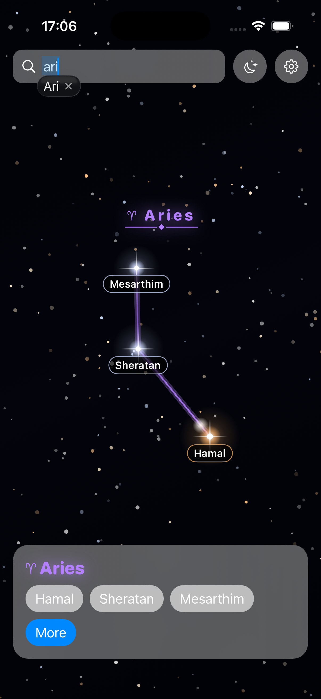

# 日専祭アプリ： 天星

> **チーム：** チーム名：『NERV』

> 氏名: 26CM0127 ハン　トゥン　ゾー (リーダ）

> メンバー名　26CM0106 カウン　ミャット　トゥー

> メンバー名　26CM0114 シャィン　コ　コ　アウン

> **AI利用レベル：** 2（生成コード可）

> **最終更新：** 2026-10-05

> 💡 制作の進め方は担任の先生から案内があります。このファイルの項目は、担任の先生の指示で増えることがあります。

> **チーム：** Nerv（26CM0106 カウン　ミャット　トゥー、26CM0114 シャィン　コ　コ　アウン、26CM0127 ハン　トゥン　ゾー）

---

## 何ができるアプリか（3行）

>このアプリは、星について詳しく知ることができるアプリです。

>星の名前や特徴、明るさなどの情報を分かりやすく紹介します。

>また、星の画像を見ることもでき、楽しみながら星について学ぶことができます。

## 画面

 

## 使った文法・技術

（例：`@State`、`List`、`ForEach`、構造体、配列の `append` と `remove`）

## 生成AIの使い方（どの場面で、どう使ったか）

（例：画面の骨組みは ChatGPT に書いてもらった。削除ボタンが効かなかったので、原因を質問して直した。）

## 展示で工夫した点

（例：文字を大きくして、来場者が操作しやすいようにした。）
